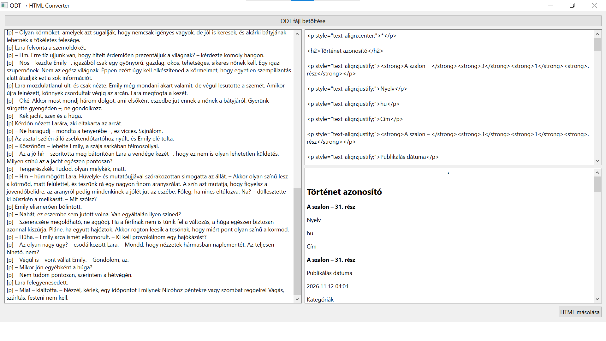

# ODT → HTML Converter

**A small desktop tool that turns LibreOffice Writer (`.odt`) documents into clean, WordPress-ready HTML.**

Pasting from a word processor into WordPress brings along messy inline styles. This tool reads the `.odt` file directly and outputs simple, predictable HTML: headings, emphasis, lists and scene breaks, nothing else. You can tweak the result in a built-in editor, check it in a live preview, and copy it to the clipboard with one click.



## Features

- Opens `.odt` files and parses their XML directly, including the document's styles
- Maps paragraph styles to `<h2>`–`<h6>`, keeps **bold** and *italic*, and normalises whitespace
- Turns empty lines into a centred `*` scene break
- Promotes the first paragraph to an `<h2>` title
- Shows the generated HTML side by side with a rendered preview
- Copies the result to the clipboard with **Copy HTML**

This project later grew into [CreateSonjaBlog](https://github.com/vfalerant/CreateSonjablog), which adds metadata, validation and direct publishing through the WordPress REST API.

## Getting started

```bash
python -m venv .venv
.venv\Scripts\activate          # Git Bash: source .venv/Scripts/activate
pip install -r requirements.txt
python main.py
```

## Project structure

```
main.py                   # entry point
converter/odt_reader.py   # reads the .odt (zip + XML), resolves styles into blocks
converter/html_generator.py  # blocks → HTML
ui/main_window.py         # PySide6 window: load, edit, preview, copy
```

## Tech

Python · PySide6 (Qt) · odfpy / defusedxml · PyInstaller
